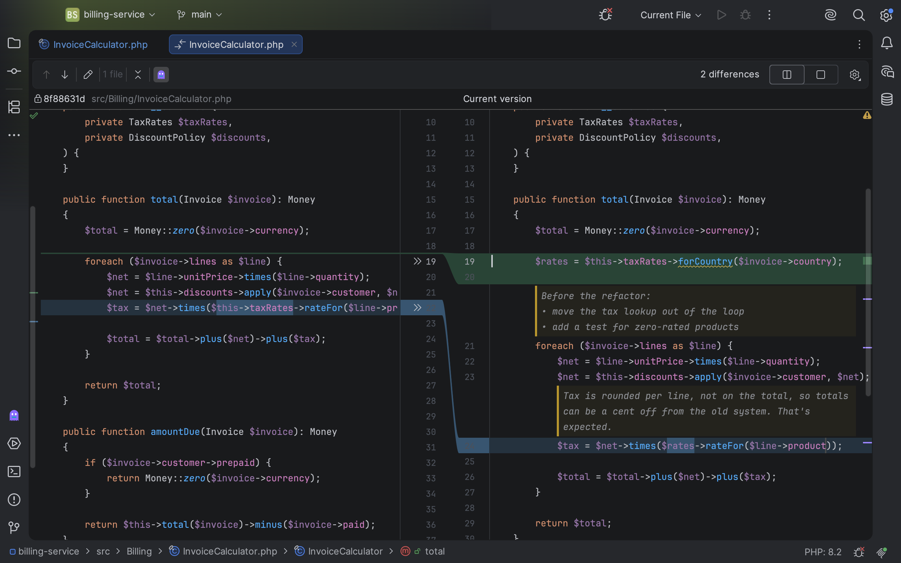

import { Aside } from '@astrojs/starlight/components';

When you look at what changed in a file, for example the changes you're about to commit, the file's notes are shown
there too. This needs Invisible Notes 1.4.1 or newer.

## Where the notes appear

Notes go with the file as it is now, so that's where a diff shows them:

- **Side-by-side viewer:** in the pane that holds the current version of the file, above their lines. The pane with
  the older version has no notes.
- **Unified viewer:** above their lines, among the old and the new lines.
- **A file you've just added:** its one pane shows the notes.

A diff that compares two older versions, such as a commit from the history, shows no notes: neither side is the
file as it is now.

## Notes are only shown there

- You can't add, edit or delete a note in a diff. Do that in the editor, and the diff follows.
- Notes aren't part of the changes. Nothing about them is committed.
- As in the editor, [orphaned notes](/invisible-notes/guides/following-code/#orphaned-notes) aren't shown.

## Hide the notes in diff views

Click the ghost button, **Show Invisible Notes**, on the toolbar of the diff. Click it again to bring the notes
back.

- The button is there whenever the diff shows a file that has notes.
- It switches the notes off in every diff view, and the IDE remembers that.
- Notes in the editor stay as they are.

## Good to know

- **In the side-by-side viewer,** a note takes up room on one side only, so that side is taller where a note is.
  The shapes between the two sides still connect the lines that belong together.
- **In the unified viewer,** a note on a changed line sits between the old line and the new one: it belongs to the
  new one.

<Aside title="Merging">
	The window for resolving merge conflicts doesn't show notes.
</Aside>
